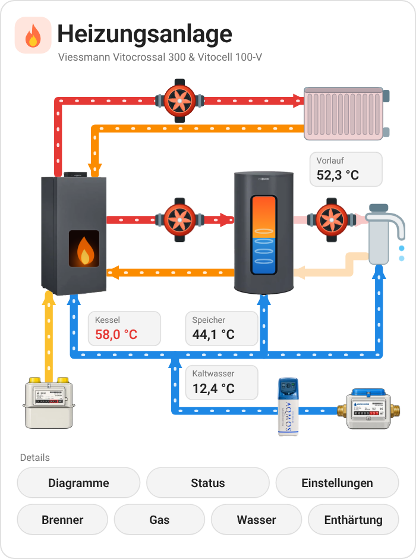
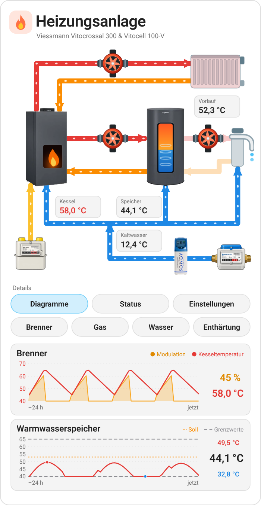
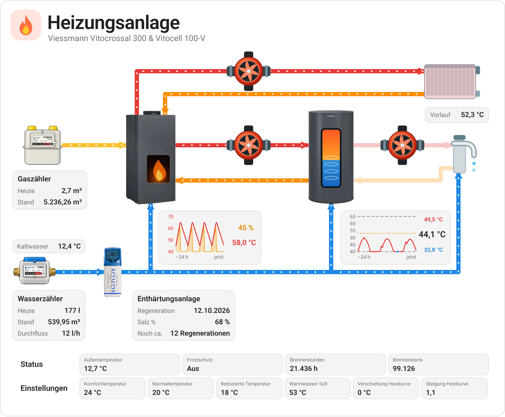

  

# Boiler Room Scheme Card

**English** | [Deutsch](https://github.com/BeGiBue/home-assistant-boiler-room-scheme-card#deutsch)

## English

Home Assistant card (`custom:heizungsanlage-card`) that shows a gas or oil heating system as an animated diagram: boiler, hot water tank, pumps, radiator, gas and water meters and water softener, with live values and history. The defaults fit a Viessmann system with the ViCare integration (Vitocrossal 300 & Vitocell 100-V); everything can be changed in the visual editor.

 

### Features

- Animated pipes and spinning pumps while the pump or water flow is active
- Burner flame sized by modulation, with a 24-hour chart of modulation and boiler temperature
- Hot water tank: the fill level in the tank window shows the tank temperature, not a water level; plus a 24-hour temperature history with setpoint and limits
- Gas and water from the Energy dashboard; units converted (m³, l/h)
- Water softener: last regeneration, salt level and estimated regenerations left, e.g. from [Water Softener Refill Sensor](https://github.com/BeGiBue/home-assistant-water-softener-refill-sensor)
- Compact view for phones and small portrait displays; tap any value for the entity dialog

The card is shown in German when Home Assistant is set to German, and in English otherwise.

### Requirements

- A set-up device integration with matching entities; the card does not include a ViCare, meter or softener integration.
- For automatic gas and water values, matching sources in the Energy dashboard, or configured meter entities.
- The entities must be recorded in history for the 24-hour charts.
- The card only displays states and opens the entity dialog; it does not call heating services itself and does not replace system monitoring.

### Which entity drives what?

| Animation / display | Trigger |
|---|---|
| Flame and glow in the burner window | `burner_active` is on or `burner_modulation` > 0 |
| Flame size | `burner_modulation` |
| Gas pipe | Burner active |
| Heating circuit pipes, pump wheel, radiator tint | `heating_pump` |
| Charging circuit to the tank, pump wheel | `charge_pump` |
| Hot water circulation, pump wheel | `dhw_circ_pump` |
| Cold water pipes, drops at the tap | `water_flow` > 0 |
| Fill level in the tank window (shows temperature, not water level) | `tank_temp`, scaled between the `tank_range` limits (default 20–65 °C) |

Independent community project, not affiliated with Viessmann or Home Assistant. Brand and product names belong to their respective owners. License: [AGPL-3.0-only](https://github.com/BeGiBue/home-assistant-boiler-room-scheme-card/blob/main/LICENSE).

## Deutsch

[English](https://github.com/BeGiBue/home-assistant-boiler-room-scheme-card#english) | **Deutsch**

Home-Assistant-Karte (`custom:heizungsanlage-card`), die eine Gas- oder Ölheizung als animiertes Anlagenschema darstellt: Kessel, Warmwasserspeicher, Pumpen, Heizkörper, Gas- und Wasserzähler und Enthärtungsanlage, mit Live-Werten und Verläufen. Die Standardwerte passen zu einer Viessmann-Anlage mit der ViCare-Integration (Vitocrossal 300 & Vitocell 100-V); alles lässt sich im grafischen Editor anpassen.

 

### Funktionen

- Animierte Leitungen und drehende Pumpen, solange Pumpe oder Durchfluss aktiv sind
- Brennerflamme nach Modulation, mit 24-h-Diagramm für Modulation und Kesseltemperatur
- Warmwasserspeicher: Die Füllanzeige im Speicherfenster zeigt die Speichertemperatur, keinen Wasserstand; dazu ein 24-h-Temperaturverlauf mit Soll- und Grenzlinien
- Gas und Wasser aus dem Energie-Dashboard; Einheiten werden umgerechnet (m³, l/h)
- Enthärtungsanlage: letzte Regeneration, Salzstand und geschätzte Rest-Regenerationen, z. B. aus [Water Softener Refill Sensor](https://github.com/BeGiBue/home-assistant-water-softener-refill-sensor)
- Kompakte Ansicht für Handy und kleine Hochformat-Displays; Tippen auf einen Wert öffnet den Entitätsdialog

Die Karte erscheint auf Deutsch, wenn Home Assistant auf Deutsch eingestellt ist, sonst auf Englisch.

### Voraussetzungen

- Eine eingerichtete Geräteintegration mit passenden Entitäten; die Karte liefert keine ViCare-, Zähler- oder Enthärtungsintegration mit.
- Für automatische Gas- und Wasserwerte passende Quellen im Energie-Dashboard oder konfigurierte Zählerentitäten.
- Für die 24-h-Verläufe müssen die Entitäten im Verlauf aufgezeichnet werden.
- Die Karte zeigt nur Zustände an und öffnet den Entitätsdialog; sie ruft selbst keine Heizungsdienste auf und ersetzt keine Anlagenüberwachung.

### Welche Entität schaltet was?

| Animation / Anzeige | Auslöser |
|---|---|
| Flamme und Glühen im Brennerfenster | `burner_active` ist an oder `burner_modulation` > 0 |
| Flammengröße | `burner_modulation` |
| Gasleitung | Brenner aktiv |
| Heizkreis-Leitungen, Pumpenrad, Heizkörper-Tönung | `heating_pump` |
| Ladekreis zum Speicher, Pumpenrad | `charge_pump` |
| Warmwasser-Zirkulation, Pumpenrad | `dhw_circ_pump` |
| Kaltwasserleitungen, Tropfen am Hahn | `water_flow` > 0 |
| Füllung im Speicherfenster (zeigt Temperatur, keinen Wasserstand) | `tank_temp`, skaliert zwischen den Grenzen aus `tank_range` (Standard 20–65 °C) |

Unabhängiges Community-Projekt, ohne Verbindung zu Viessmann oder Home Assistant. Marken und Produktnamen gehören ihren jeweiligen Rechteinhabern. Lizenz: [AGPL-3.0-only](https://github.com/BeGiBue/home-assistant-boiler-room-scheme-card/blob/main/LICENSE).
